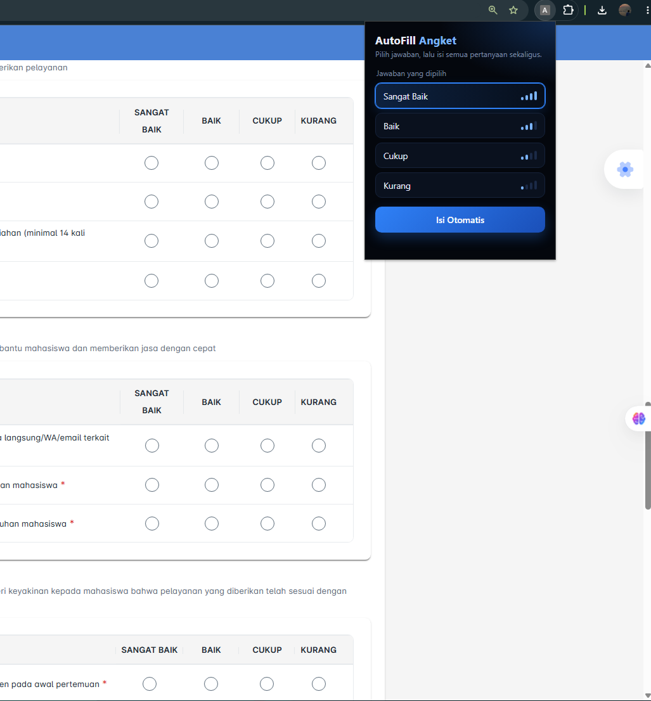

# PENGISIAN_ANGKET-AUT0

Chrome extension (Manifest V3) untuk mengisi angket berbasis radio button secara otomatis, supaya tidak perlu klik jawaban satu per satu.

## Fitur
- Isi otomatis radio button pada halaman angket
- Dijalankan lewat popup extension di halaman yang sedang dibuka
- [ISI: cara jawaban dipilih, misalnya skala tertentu, acak, atau pilihan sendiri]

## Struktur Folder
```
PENGISIAN_ANGKET-AUT0/
├── autofill-angket/
│   ├── manifest.json
│   ├── popup.html
│   └── [ISI: file lain, misalnya popup.js]
├── LICENSE
└── README.md
```

## Instalasi
1. Clone repo ini:
   ```bash
   git clone https://github.com/YusAidil/PENGISIAN_ANGKET-AUT0.git
   ```
2. Buka Chrome, masuk ke `chrome://extensions`
3. Aktifkan **Developer mode** (pojok kanan atas)
4. Klik **Load unpacked**, lalu pilih folder `autofill-angket`

## Cara Pakai
1. Buka halaman angket yang ingin diisi
2. Klik ikon **AutoFill Angket** di toolbar Chrome
3. [ISI: langkah di popup, misalnya pilih opsi lalu klik tombol isi]
4. Periksa hasilnya sebelum menekan tombol kirim

## Izin yang Digunakan
| Izin | Kegunaan |
|------|----------|
| `activeTab` | Mengakses tab yang sedang dibuka saat extension diklik |
| `scripting` | Menjalankan script pengisi jawaban di halaman |
| `host_permissions: <all_urls>` | Agar bisa dipakai di situs angket mana pun |




## Disclaimer
Tool ini dibuat untuk belajar dan mempermudah pengisian formulir pribadi. Gunakan dengan jujur dan bijak. Jangan dipakai untuk memanipulasi data survei/penelitian orang lain atau melanggar aturan platform. Risiko penggunaan ada pada pengguna.

## Lisensi
[MIT](LICENSE) © 2026 Yus Aidil
